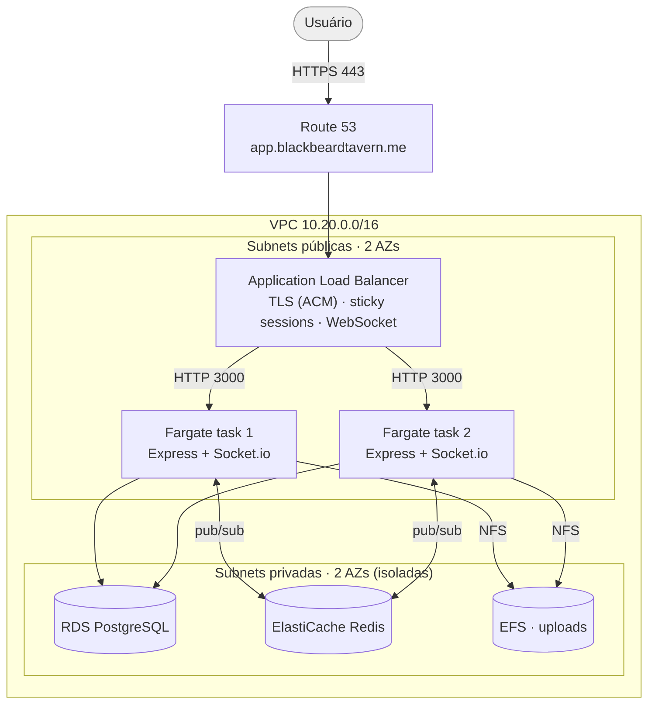
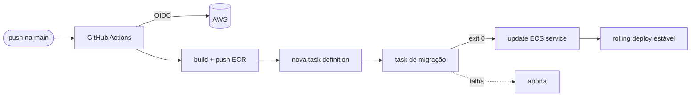

# Arquitetura

A Blackbeard Tavern roda na AWS como uma aplicação containerizada, provisionada
inteiramente por Terraform e entregue por um pipeline de CI/CD.

## Diagrama

## Componentes

| Camada | Serviço AWS | Papel |
|---|---|---|
| DNS | Route 53 | Hosted zone delegada do subdomínio; alias A → ALB |
| TLS | ACM | Certificado gratuito, validação por DNS |
| Entrada | Application Load Balancer | Termina TLS, redireciona 80→443, encaminha WebSocket |
| Compute | ECS Fargate | Container Node (Express + Socket.io), serve API + frontend |
| Banco | RDS PostgreSQL | Dados relacionais (usuários, feed, chat, eventos...) |
| Cache | ElastiCache Redis | Adapter do Socket.io entre instâncias |
| Mídia | EFS | Uploads (fotos/vídeos) compartilhados e persistentes |
| Imagens | ECR | Registro das imagens Docker |
| Segredos | Secrets Manager | Credenciais do banco, JWT, chave do Resend |
| Observabilidade | CloudWatch Logs + Container Insights | Logs e métricas |

## Rede (modo enxuto)

- **Subnets públicas** hospedam o ALB e as tasks Fargate. As tasks recebem IP
  público e alcançam ECR, Secrets Manager e a API do Resend pelo Internet
  Gateway — o que **dispensa o NAT Gateway** (economia de ~US$32/mês).
- **Subnets privadas** hospedam RDS, Redis e EFS, sem rota para a internet.
- **Security groups encadeados**: o ALB aceita 80/443 da internet; as tasks
  aceitam a porta do app **apenas do ALB**; banco (5432), Redis (6379) e EFS
  (2049) aceitam tráfego **apenas das tasks**.

## WebSocket em tempo real atrás do ALB

Este é o ponto técnico mais interessante da arquitetura.

O app usa **Socket.io** para chat, notificações e o campus virtual multiplayer.
Colocar WebSocket atrás de um load balancer com múltiplas instâncias tem três
armadilhas, tratadas assim:

1. **Upgrade de protocolo e conexões longas.** O ALB (camada 7) faz o upgrade
   HTTP→WebSocket nativamente; o `idle_timeout` foi elevado para 3600s para não
   derrubar conexões ociosas.

2. **Afinidade de sessão.** O handshake do Socket.io e o fallback de
   long-polling exigem que o cliente fale sempre com a mesma task. O target
   group usa **sticky sessions** (cookie do LB).

3. **Estado distribuído entre instâncias.** Com 2+ tasks, cada processo só
   enxerga os sockets conectados a ele. Duas medidas resolvem:
   - **Adapter Redis** (`@socket.io/redis-adapter`): propaga eventos de salas e
     broadcasts entre todas as instâncias via pub/sub.
   - **Salas por usuário** (`user:<id>`): cada socket entra numa sala com o id
     do usuário; mensagens e notificações são emitidas para a sala, não para um
     socket específico. Assim o evento chega a todas as abas do usuário, em
     qualquer instância. O mesmo padrão permite ao admin desconectar um usuário
     banido em todas as instâncias (`disconnectSockets` sobre a sala).

   > Esse desenho é **compatível com uma instância só** (padrão `desired_count = 1`):
   > emitir para `user:<id>` com uma task equivale a mirar os sockets locais.
   > Subir para `desired_count = 2` com Redis demonstra a escala horizontal sem
   > mudar o comportamento.

## Estado e persistência

- **Containers são efêmeros.** Nenhum dado de usuário vive no container.
- **Uploads** vão para o **EFS**, montado em `/data/media` e compartilhado por
  todas as tasks — sobrevivem a deploys e troca de instância.
- **Migrações** são idempotentes (tabela `schema_migrations`) e rodam como uma
  task one-off no pipeline, antes de atualizar o service.

## Fluxo de deploy (CI/CD)

Autenticação por **OIDC**: o GitHub assume uma role IAM temporária, sem chaves
de acesso de longa duração armazenadas no repositório.
